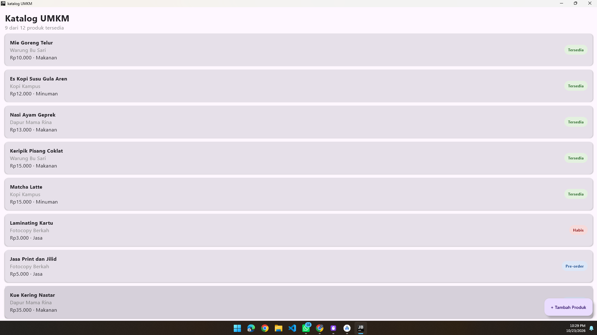
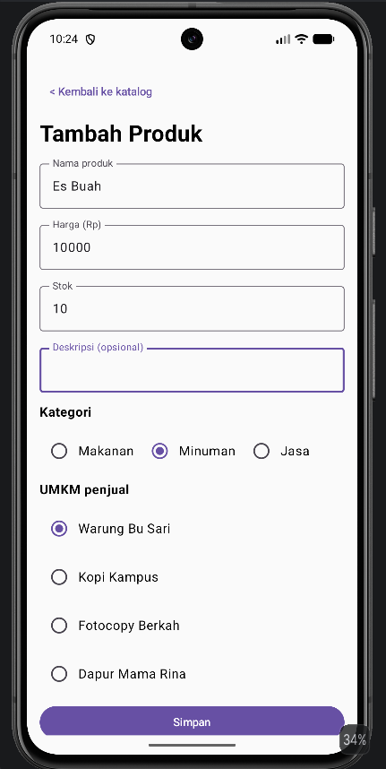
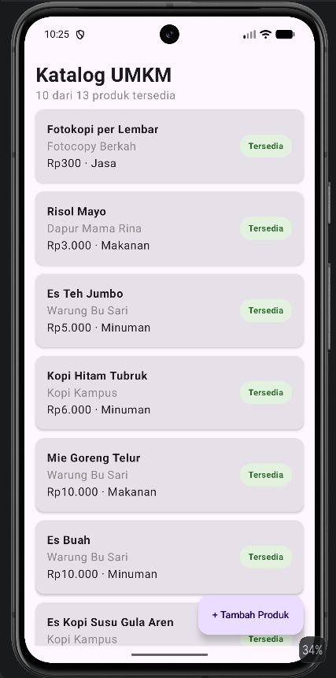

# Katalog UMKM

##  Deskripsi Proyek

**Katalog UMKM** adalah aplikasi mobile berbasis **Kotlin Multiplatform (KMP)** yang digunakan untuk menampilkan dan mengelola informasi produk dari Usaha Mikro, Kecil, dan Menengah (UMKM).

Aplikasi ini dikembangkan sebagai proyek kelompok pada mata kuliah **Pengembangan Aplikasi Mobile**. Proyek menggunakan konsep Kotlin Multiplatform sehingga kode yang dapat digunakan bersama ditempatkan pada `commonMain`, sedangkan kode yang membutuhkan implementasi khusus platform ditempatkan pada source set masing-masing platform.

##  Tujuan

- Menyediakan katalog produk UMKM dalam bentuk aplikasi mobile.
- Menampilkan informasi produk secara terstruktur.
- Menerapkan konsep dasar Kotlin dan Kotlin Multiplatform.
- Memahami struktur project KMP.
- Menerapkan konsep `commonMain` dan kode khusus platform.
- Membiasakan penggunaan Git dan GitHub dalam pengembangan aplikasi secara berkelompok.

##  Anggota Kelompok

| No | Nama | NIM | Peran |
|----|------|-----|-------|
| 1 | **Bayu Setiawan** | **124140177** | Ketua Kelompok |
| 2 | **Arbani Hafizh Saragih** | **124140139** | Anggota Kelompok |
| 3 | **Natan Handani** | **124140175** | Anggota Kelompok |

##  Checkpoint Minggu 1

| No | Yang diselesaikan | Status |
|----|-------------------|--------|
| 1 | Proyek KMP kelompok dibuat dari template Compose Multiplatform dan di-push ke repository kelompok | Selesai |
| 2 | Judul aplikasi diganti dengan nama tema, dan nama platform ikut tampil memakai expect dan actual | Selesai |
| 3 | Setiap anggota punya satu commit, misalnya menambahkan nama dan NIM di layar Tentang | Selesai |

###  Screenshot Aplikasi


## Checkpoint Minggu 2

| No | Yang diselesaikan | Dikerjakan oleh | Status |
|----|-------------------|-----------------|--------|
| 1 | Model data: Produk, Umkm, sealed class StatusProduk di commonMain/model | Bayu | Selesai |
| 2 | Sumber data palsu: interface Sumber, SumberProdukPalsu (delay + Flow status) | Arbani | Selesai |
| 3 | Bukti berjalan: DemoCheckpoint2.kt di jvmMain | Natan | Selesai |

### keluaran konsol


## Checkpoint Minggu 3

| No | Yang diselesaikan | Dikerjakan oleh | Status |
|---|---|---|---|
| 1 | Data contoh 12 produk (DataContoh.kt), LazyColumn DaftarProduk | Arbani | Selesai |
| 2 | Komponen KartuProduk dan LabelStatus | Bayu | Selesai |
| 3 | LayarKatalog: urutan Tersedia + termurah, FAB Tambah Produk, App.kt, README | Natan | Selesai |

### Tangkapan layar



## Checkpoint Minggu 4

| No | Yang diselesaikan | Dikerjakan oleh | Status |
|----|-------------------|-----------------|--------|
| 1 | FormProdukUiState (bisaSimpan dihitung) dan FormProdukViewModel (StateFlow, validasi) | Bayu | Selesai |
| 2 | Layar FormProdukScreen dan KolomTeks tanpa state | Natan | Selesai |
| 3 | PenyimpananProduk (MutableStateFlow), FAB onTambah, App.kt membaca daftar | Arbani | Selesai |

### Tangkapan layar

| Form tambah produk | Katalog setelah produk ditambah |
|---|---|
|  |  |

##  Mata Kuliah

**Pengembangan Aplikasi Mobile**

**Program Studi:** Teknik Informatika  
**Institusi:** Institut Teknologi Sumatera (ITERA)  
**Tahun:** 2026

##  Teknologi yang Digunakan

- Kotlin
- Kotlin Multiplatform (KMP)
- Compose Multiplatform
- Android Studio
- Gradle
- Git
- GitHub

##  Struktur Project

```text
katalog-umkm/
├── shared/
│   └── src/
│       ├── commonMain/
│       │   └── kotlin/id/ac/itera/katalogumkm/
│       │       ├── model/
│       │       │   ├── Produk.kt
│       │       │   ├── Umkm.kt
│       │       │   ├── StatusProduk.kt
│       │       │   └── ProdukExt.kt
│       │       └── data/
│       │           ├── Sumber.kt
│       │           ├── SumberProdukPalsu.kt
│       │           └── SumberUmkmPalsu.kt
│       ├── jvmMain/
│       │   └── kotlin/id/ac/itera/katalogumkm/
│       │       └── DemoCheckpoint2.kt
│       ├── androidMain/
│       └── iosMain/
├── androidApp/
├── desktopApp/
├── iosApp/
├── gradle/
│   └── libs.versions.toml
├── build.gradle.kts
└── settings.gradle.kts
```
