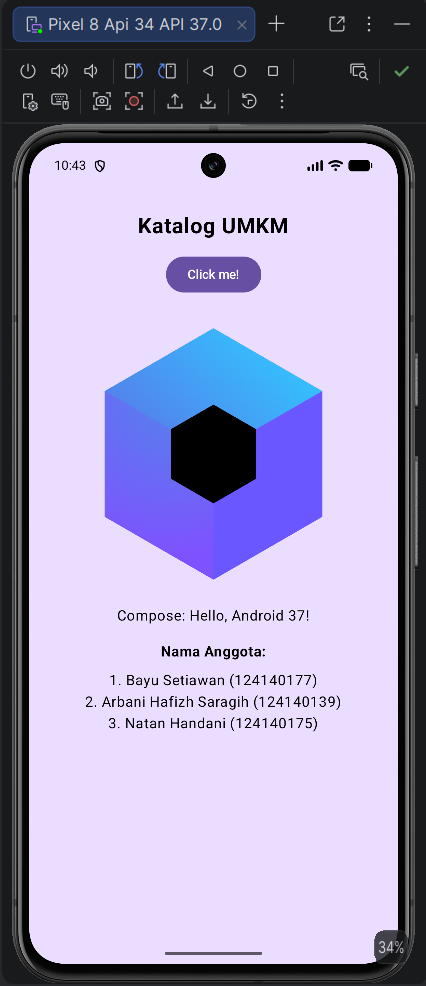

# Katalog UMKM

## 📱 Deskripsi Proyek

**Katalog UMKM** adalah aplikasi mobile berbasis **Kotlin Multiplatform (KMP)** yang digunakan untuk menampilkan dan mengelola informasi produk dari Usaha Mikro, Kecil, dan Menengah (UMKM).

Aplikasi ini dikembangkan sebagai proyek kelompok pada mata kuliah **Pengembangan Aplikasi Mobile**. Proyek menggunakan konsep Kotlin Multiplatform sehingga kode yang dapat digunakan bersama ditempatkan pada `commonMain`, sedangkan kode yang membutuhkan implementasi khusus platform ditempatkan pada source set masing-masing platform.

## 🎯 Tujuan

- Menyediakan katalog produk UMKM dalam bentuk aplikasi mobile.
- Menampilkan informasi produk secara terstruktur.
- Menerapkan konsep dasar Kotlin dan Kotlin Multiplatform.
- Memahami struktur project KMP.
- Menerapkan konsep `commonMain` dan kode khusus platform.
- Membiasakan penggunaan Git dan GitHub dalam pengembangan aplikasi secara berkelompok.

## 👥 Anggota Kelompok

| No | Nama | NIM | Peran |
|----|------|-----|-------|
| 1 | **Bayu Setiawan** | **124140177** | Ketua Kelompok |
| 2 | **Arbani Hafizh Saragih** | **124140139** | Anggota Kelompok |
| 3 | **Natan Handani** | **124140175** | Anggota Kelompok |

## 📌 Checkpoint Minggu 1

| No | Yang diselesaikan | Status |
|----|-------------------|--------|
| 1 | Proyek KMP kelompok dibuat dari template Compose Multiplatform dan di-push ke repository kelompok | Selesai |
| 2 | Judul aplikasi diganti dengan nama tema, dan nama platform ikut tampil memakai expect dan actual | Selesai |
| 3 | Setiap anggota punya satu commit, misalnya menambahkan nama dan NIM di layar Tentang | Selesai |

### 📸 Screenshot Aplikasi



## 📚 Mata Kuliah

**Pengembangan Aplikasi Mobile**

**Program Studi:** Teknik Informatika  
**Institusi:** Institut Teknologi Sumatera (ITERA)  
**Tahun:** 2026

## 🛠️ Teknologi yang Digunakan

- Kotlin
- Kotlin Multiplatform (KMP)
- Compose Multiplatform
- Android Studio
- Gradle
- Git
- GitHub

## 🏗️ Struktur Project

```text
katalog-umkm/
├── composeApp/
│   └── src/
│       ├── commonMain/
│       │   └── kotlin/
│       ├── androidMain/
│       │   └── kotlin/
│       ├── iosMain/
│       │   └── kotlin/
│       └── desktopMain/
│           └── kotlin/
├── gradle/
│   └── libs.versions.toml
├── build.gradle.kts
└── settings.gradle.kts
```
